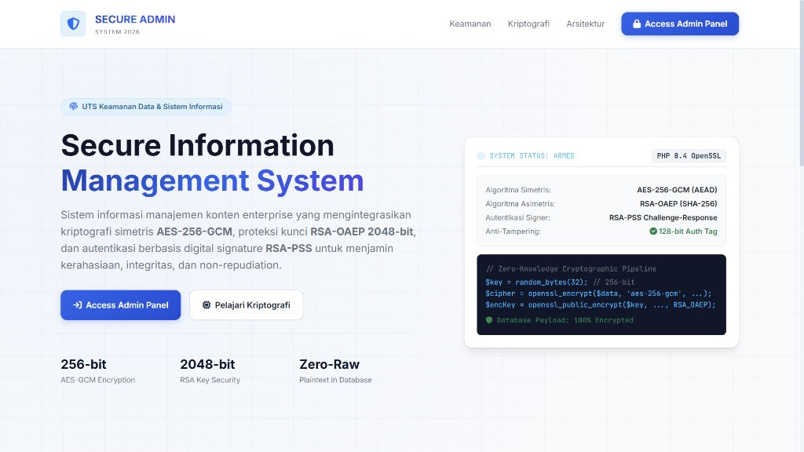

# SECURE ADMIN SYSTEM
## Ujian Tengah Semester (UTS) - Keamanan Data dan Sistem Informasi
> **Sistem Informasi Berbasis PHP Native dengan Kriptografi Simetris (AES-256-GCM) dan Asimetris (RSA-OAEP & RSA-PSS 2048-Bit)**

---

### IDENTITAS MAHASISWA
- **Nama Mahasiswa** : [Muhammad Hafizh Akbar Solehudin]
- **NIM**            : [2430511012]
- **Program Studi**  : Teknik Informatika
- **Mata Kuliah**    : Keamanan Data dan Informasi
- **Dosen Pengampu** : [Asril Adi Sunarto, S.T, M.Kom]
- **Institusi**      : Universitas Muhammadiyah Sukabumi 
- **Tautan Repositori GitHub** : `https://github.com/hafizhakbar3105/uts_keamanan-data.git`

---

## 📸 TAMPILAN HALAMAN MUKA (LANDING PAGE)

Sesuai butir soal nomor 1, sistem dilengkapi dengan *landing page* publik yang berfungsi sebagai pintu gerbang masuk menuju panel administrator:


*Gambar: Halaman Muka (Landing Page) Secure Information Management System sebagai Pintu Gerbang Masuk Admin*

---

## 1. PENJELASAN TENTANG PRAKTIKUM UTS YANG DIKERJAKAN

Proyek ini adalah pembangunan sistem informasi terproteksi berbasis **PHP Native 8.2+** tanpa menggunakan *framework* pihak ketiga (tanpa Laravel/CodeIgniter) untuk memenuhi seluruh instruksi lembar soal UTS **Keamanan Data dan Sistem Informasi**:

### Ringkasan Pemenuhan Soal UTS:

| No | Ketentuan Soal UTS | Implementasi pada Sistem |
|:--:|---|---|
| **1** | **Aplikasi berbasis PHP Native & Landing Page** | Dibangun dengan PHP Native murni, PDO MySQL, HTML5/CSS3. Halaman muka `index.php` bertindak sebagai portal publik yang mengarahkan pengunjung menuju `login.php`. |
| **2** | **Paradigma Login: Input Kunci Simetris & Asimetris** | Formulir login pada `login.php` dirombak dari login konvensional menjadi input dua kunci: **Kunci Simetris** (`AdminSecure2026!`) dan **Kunci Asimetris** (*RSA Private Key PEM 2048-bit*). |
| **3** | **Konten di Halaman Admin Berisi Hasil Enkripsi (Ciphertext)** | Halaman `contents.php` menyimpan dan menampilkan 100% data dalam bentuk **Ciphertext** melalui enkripsi simetris AES-256-GCM dan dibungkus asimetris RSA-OAEP (*Zero-Plaintext Storage*). |
| **4** | **Link Kode Program & Basis Data Disertakan** | Seluruh kode sumber beserta skema SQL (`database/secure_admin_system.sql`) dilampirkan dalam repositori GitHub ini. |

---

## 2. ARSITEKTUR KEAMANAN & KRIPTOGRAFI

Sistem ini menerapkan pertahanan berlapis (*Defense-in-Depth*) dengan standar keamanan modern:

1. **Kriptografi Simetris: AES-256-GCM (Authenticated Encryption)**
   - Mengenkripsi judul dan isi konten dokumen secara efisien.
   - Menghasilkan **Authentication Tag 128-bit** dan **Nonce 96-bit** (Standar NIST SP 800-38D). Jika ada penyusup yang mengubah 1 bit saja data di basis data, dekripsi otomatis menolak data tersebut (*Anti-Tampering*).
2. **Kriptografi Asimetris: RSA-OAEP 2048-Bit (Key Wrapping)**
   - Kunci simetris AES yang dipakai mengenkripsi konten dibungkus menggunakan Kunci Publik RSA dengan bantalan OAEP (*Optimal Asymmetric Encryption Padding*).
   - Kunci AES hanya dapat dibuka oleh administrator yang memegang Kunci Privat RSA yang sah.
3. **Autentikasi Challenge-Response (RSA-PSS Digital Signature)**
   - Kunci privat admin **tidak pernah dikirim ke server**.
   - Browser admin memanfaatkan *W3C Web Crypto API* (`window.crypto.subtle`) untuk menandatangani token tantangan (*challenge token*) acak 32-byte berbatas waktu 2 menit (*Anti-Replay Attack*).
4. **Zero-Plaintext Storage**
   - Basis data MySQL (`contents`) sama sekali tidak menyimpan teks biasa. Semua kolom sensitif (`encrypted_title`, `encrypted_content`, `encrypted_aes_key`) berwujud *Ciphertext Base64*.

---

## 3. STRUKTUR FOLDER PROYEK

```text
uts-keamanan/
├── assets/
│   ├── css/style.css             # Tema Light modern, clean, dan responsif
│   ├── js/script.js              # Penandatanganan RSA Web Crypto di browser
│   └── screenshots/
│       └── landing_page.jpg      # Tangkapan layar landing page website
├── config/
│   ├── database.php              # Koneksi PDO singleton & aman (Anti-SQLi)
│   └── security.php              # Session hardening, CSRF token, rate limiter
├── crypto/
│   ├── aes.php                   # Modul AES-256-GCM (AEAD 128-bit Tag)
│   ├── rsa.php                   # Modul RSA-OAEP 2048-bit & Digital Signature
│   ├── hybrid.php                # Modul Enkripsi Hibrida (AES + RSA)
│   ├── get_test_key.php          # Endpoint muat kunci pengujian
│   └── test_all_features.php     # Skrip otomatis pengujian 12 skenario
├── database/
│   └── secure_admin_system.sql   # Skema DDL MySQL dan data awal admin
├── storage/keys/
│   ├── .htaccess                 # Proteksi akses langsung browser (Require all denied)
│   ├── private_key.pem           # Kunci privat RSA pengujian (2048-bit)
│   └── public_key.pem            # Kunci publik RSA pengujian (2048-bit)
├── audit.php                     # Log aktivitas & audit trail (Ekspor CSV)
├── categories.php                # Kelola kategori dokumen rahasia
├── contents.php                  # Kelola konten admin (100% Ciphertext & Modal Dekripsi)
├── dashboard.php                 # Dasbor admin & telemetri sistem
├── encryption.php                # Laboratorium interaktif kriptografi & tamper test
├── index.php                     # Landing page publik (Pintu masuk admin)
├── login.php                     # Login dua kunci: Kunci Simetris & Asimetris
├── logout.php                    # Terminasi sesi aman
├── .gitignore                    # Pencegah kebocoran file privat ke Git
└── README.md                     # Dokumentasi resmi proyek
```

---

## 4. PANDUAN MENJALANKAN SISTEM DI LARAGON

### 1. Menyiapkan Proyek
Pastikan folder proyek berada pada direktori web server:
```text
C:\laragon\www\uts-keamanan
```

### 2. Mengaktifkan Layanan Laragon
Buka aplikasi **Laragon**, kemudian klik tombol **Start All** untuk mengaktifkan Apache dan MySQL.

### 3. Mengimpor Basis Data
1. Buka browser dan akses **phpMyAdmin** (`http://localhost/phpmyadmin`) atau buka **HeidiSQL**.
2. Buat basis data baru bernama `secure_admin_system`.
3. Buka tab **Import**, pilih berkas:
   ```text
   database/secure_admin_system.sql
   ```
4. Klik **Go / Import** hingga seluruh tabel berhasil dibuat.

---

## 5. KREDENSIAL DEFAULT PENGUJIAN

Untuk keperluan penilaian dan demonstrasi:

- **URL Aplikasi** : `http://localhost/uts-keamanan/` *(atau via virtual host Laragon: `http://uts-keamanan.test`)*
- **Halaman Login Admin** : `http://localhost/uts-keamanan/login.php`
- **Username** : `admin`
- **1. Kunci Simetris** : `AdminSecure2026!`
- **2. Kunci Asimetris (RSA Private Key)** :
  - Klik tombol **"Muat Kunci Pengujian"** pada formulir login untuk mengisi otomatis.
  - Atau salin langsung dari berkas `storage/keys/private_key.pem`.

---

## 6. HASIL PENGUJIAN OTOMATIS (TEST SUITE)

Seluruh fungsi kriptografi, proteksi SQL Injection, mitigasi Replay Attack, dan validasi dekripsi diuji secara komprehensif menggunakan terminal:

```bash
php crypto/test_all_features.php
```
